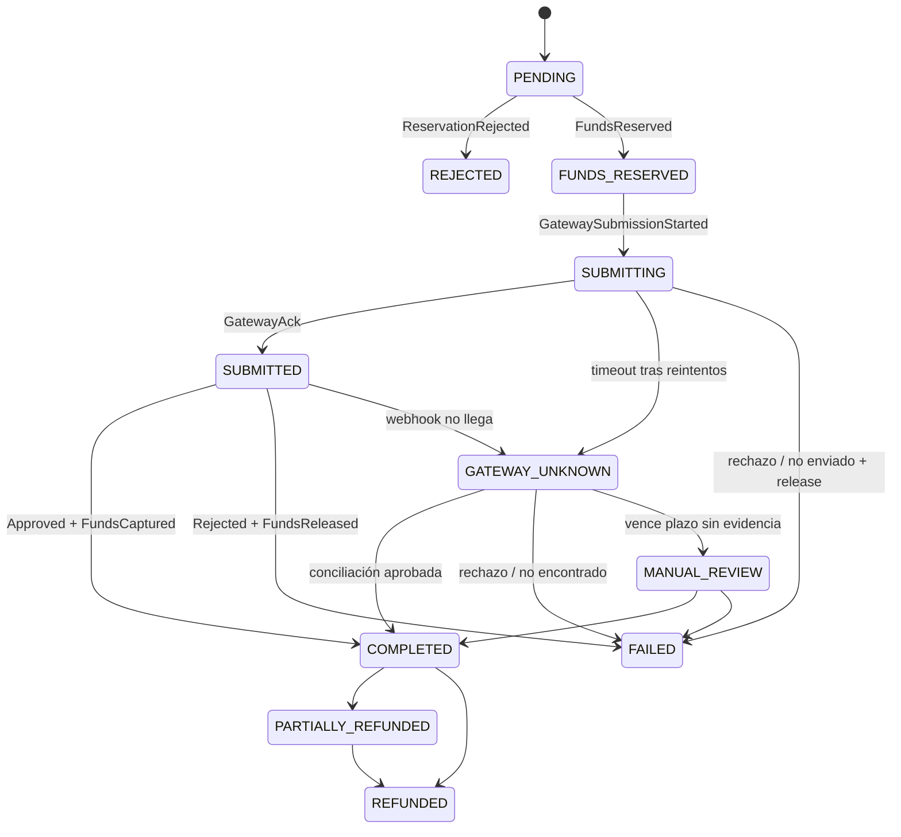

# draftea-task-1-architecture

---

## [User] 
Acabo de adjuntar el enunciado de un challenge técnico para Senior Backend (Sistema de Pagos Orientado a Eventos). Vamos a encararlo de forma ordenada: por ahora nos enfocamos exclusivamente en la Parte 1 (Diseño de Arquitectura). No escribas código Go ni generes archivos todavía.

Quiero que trabajemos como pares diseñando la solución desde cero y discutiendo los trade-offs antes de bajar todo a documentación. Para esta primera iteración, ayudame a desglosar y debatir estos 3 puntos:

Descomposición de servicios: Qué servicios mínimos y bien delimitados tiene sentido definir para cubrir pagos, billetera, integración asincrónica con pasarela externa y métricas sin caer en sobre-ingeniería.

Coordinación y consistencia: Comparativa breve entre Saga Orquestada vs. Coreografiada para este flujo de pagos, y cómo encajan Event Sourcing + CQRS en la gestión de la billetera (considerando que la Parte 2 pide explícitamente Event Store y Read Models).

Stack de mensajería y persistencia: Qué broker de mensajes (Kafka vs. RabbitMQ) y bases de datos recomendás para producción y por qué, pensando en orden de eventos, idempotencia y consistencia financiera.

Dame tu análisis conciso sobre estos tres puntos para que los discutamos y definamos la arquitectura base antes de pasar a los flujos de error, escenarios borde y diagramas.

## [Assistant]
Ya leí el enunciado. Antes de entrar en los tres puntos hay que aclarar una ambigüedad que condiciona el resto. El enunciado dice que el usuario paga **con saldo de billetera**, pero también habla de una **pasarela externa con respuesta asincrónica**. Yo lo interpreto así: la billetera financia el pago y la pasarela liquida al proveedor del servicio. Por eso el flujo es *reservar saldo → enviar a la pasarela → confirmar o liberar*. Si lo ves distinto, por ejemplo que la pasarela solo se usa para cargar saldo, cambia bastante la saga.

---

## 1. Qué servicios definir

Propongo **4 servicios** con responsabilidades bien separadas:

| Servicio | Responsabilidad | Dueño de |
|---|---|---|
| **Payment** | Recibe el pago por API (con clave de idempotencia). Lleva el estado del pago y **coordina la saga**. | Estados del pago: `PENDING → FUNDS_RESERVED → SUBMITTED → COMPLETED / FAILED / REFUNDED` |
| **Wallet** | Es la fuente de verdad del saldo. Reserva, cobra, libera, reembolsa y acredita. Hace cumplir que el saldo no quede negativo. | Historial de eventos de cada billetera, que funciona como libro contable |
| **Gateway Adapter** | Traduce entre nuestro modelo y el del proveedor externo, para que el proveedor no contamine el dominio. Maneja timeouts, reintentos y circuit breaker, recibe los webhooks y consulta estados para conciliar. | Registro de intentos ante la pasarela y su conciliación |
| **Metrics** | Solo consume eventos y arma vistas agregadas (tasa de éxito, latencias, volumen). | Vistas analíticas |

**Lo que no separaría:**
- **Orquestador de saga aparte:** vive dentro de Payment.
- **Ledger aparte de Wallet:** el historial de eventos de Wallet ya cumple ese rol.
- **Notificaciones, usuarios y servicio de lecturas aparte:** las vistas de lectura viven dentro de cada servicio.
- **API Gateway:** es infraestructura, no dominio.

> **Para la Parte 2 (4 hs):** propongo un **monolito modular**, con módulos aislados que se comunican por un bus de eventos detrás de una interfaz (en memoria o un broker simulado). Así mostramos que los límites están bien puestos sin cargar con la complejidad operativa de varios procesos.

---

## 2. Coordinación y consistencia

### Saga orquestada vs. coreografiada

| | Orquestada | Coreografiada |
|---|---|---|
| Ver en qué estado está un pago | Explícito, en una sola máquina de estados | Hay que reconstruirlo cruzando eventos de varios servicios |
| Compensaciones | Centralizadas y fáciles de testear | Repartidas entre servicios; aparecen dependencias cruzadas |
| Timeouts y estados inciertos | El orquestador programa los vencimientos y decide | Nadie es dueño del timeout |
| Acoplamiento | El orquestador conoce los pasos | Bajo, pero la lógica de negocio queda implícita |
| Cuándo conviene | Flujos financieros con compensación | Efectos secundarios que no deciden nada |

**Propuesta: un esquema híbrido.**
- El flujo del dinero va **orquestado por Payment**: comandos a Wallet y al Gateway, eventos de respuesta.
- Metrics (y a futuro las notificaciones) escuchan los eventos de dominio de forma **coreografiada**, sin acoplarse al flujo.

**Punto crítico para defender:** un timeout de la pasarela **no es un rechazo, es un estado incierto**. No se libera la reserva enseguida, porque si la pasarela sí procesó el pago, perdemos plata. El orquestador pasa el pago a `GATEWAY_UNKNOWN` y luego:
- Reintenta enviando el mismo `payment_id` como clave de idempotencia ante el proveedor.
- Si no hay respuesta, consulta el estado o concilia.
- Recién con un rechazo confirmado (o tras vencer una ventana de conciliación definida por política) compensa con `ReleaseFunds`.

### Event Sourcing + CQRS en la billetera

- **Escritura:** cada billetera guarda su historia como eventos (`WalletCreated`, `FundsDeposited`, `FundsReserved`, `ReservationRejected`, `FundsCaptured`, `FundsReleased`, `FundsRefunded`). El saldo disponible se calcula como `balance - holds`.
- **Concurrencia:** control optimista. La tabla tiene una restricción única sobre `(stream_id, version)` y cada escritura indica qué versión espera; si hay conflicto, se recarga y se reintenta. Esto resuelve el escenario 4 (pagos concurrentes) sin bloqueos.
- **Snapshots** cada N eventos para que reconstruir el estado sea rápido.
- **Lectura:** vistas de saldo, movimientos y estado del pago, que quedan consistentes con cierto retraso.
- **Regla de oro:** la validación de saldo se hace **siempre contra el estado reconstruido de la billetera, nunca contra la vista de lectura**.
- **Recuperación (escenario 5):** las vistas se reconstruyen reproduciendo los eventos, y la saga se retoma desde su último estado guardado.
- **Reservar y cobrar vs. cobrar y reembolsar:** prefiero *reservar → cobrar / liberar*. El dinero comprometido queda visible y la compensación es solo liberar la reserva, no un reembolso contable.
- **Payment:** también lo haría con Event Sourcing. Cuesta poco una vez que ya tenemos el event store y nos da auditoría y recuperación de la saga. La alternativa más simple es una tabla de estado con outbox; lo dejo abierto.

---

## 3. Mensajería y persistencia

### Broker: **Kafka**

| Criterio | Kafka | RabbitMQ |
|---|---|---|
| Orden | Garantizado dentro de cada partición, según la clave del mensaje | Se pierde cuando varios consumidores compiten por la misma cola |
| Volver a leer eventos (replay) | Nativo, gracias a la retención | No lo tiene (RabbitMQ Streams existe pero está menos maduro) |
| Throughput / escala horizontal | Muy alto, con grupos de consumidores | Menor |
| Reintentos con delay y cola de fallidos | Hay que armarlos con topics de reintento y un DLQ | Nativo (DLX y TTL por mensaje) |
| Operación | Más compleja; se mitiga con un servicio gestionado (MSK / Confluent) | Más simple |

**Por qué Kafka:**
- El orden por clave es lo más importante. Usando `wallet_id` como clave, todos los comandos de una misma billetera se procesan en serie, lo que reduce mucho los conflictos de concurrencia. El control optimista queda igual como red de seguridad.
- Poder releer eventos permite reconstruir vistas y reprocesar métricas.
- Lo que Kafka no trae (reintentos con backoff y DLQ) se cubre con el patrón `payments.retry.{5s,1m,10m}` → `payments.dlq`.
- **No sumaría RabbitMQ además:** dos brokers no se justifican.

**Garantía de entrega:** *al menos una vez* + **consumidores idempotentes**.
- Cada consumidor registra el `event_id` ya procesado en la misma transacción en la que cambia su estado (patrón inbox).
- El exactly-once de Kafka no cruza a la base de datos ni a la pasarela; lo que conseguimos es un efecto exactly-once gracias a la idempotencia.
- Idempotencia en tres niveles:
  - Header `Idempotency-Key` en la API.
  - `event_id` en los consumidores.
  - `payment_id` ante el proveedor externo.

### Bases de datos

- **PostgreSQL** para el event store, las vistas de lectura y el outbox. Una base lógica por servicio.
  - El event store es una tabla de solo inserción: `(global_seq, stream_id, version, type, payload jsonb, metadata, created_at)` con restricción única en `(stream_id, version)`.
  - Le da ACID y restricciones únicas para la concurrencia, y es tecnología que cualquier equipo sabe operar.
  - **Sin dual-write:** se escribe el evento en Postgres y un relay (polling o Debezium) lo publica en Kafka. El event store hace de outbox.
  - Alternativas descartadas: EventStoreDB (muy especializado, menos conocido para operar) y DynamoDB con escrituras condicionales (válida a mucha escala, pero ata el diseño a un proveedor).
- **Métricas:**
  - Operativas: Prometheus + Grafana.
  - De negocio: TimescaleDB, que mantiene todo en Postgres. ClickHouse si el volumen analítico crece mucho.
- **Redis (opcional):** para resolver rápido las claves de idempotencia y para rate limiting. **Nunca para decidir sobre el saldo.**
- **Montos** en `int64` en unidades mínimas (centavos) más código de moneda, nunca `float`.

---

## Para definir antes de seguir

1. **Rol de la pasarela:** ¿confirmás que liquida el pago al proveedor y no se usa solo para cargar saldo?
2. **Reservar/cobrar vs. cobrar/reembolsar:** ¿vamos con reservar y cobrar?
3. **Payment:** ¿con Event Sourcing o con tabla de estado + outbox?
4. **Parte 2:** ¿monolito modular con bus simulado, o binarios separados?

Cuando cerremos esto, paso a los flujos de error, los 5 escenarios y los diagramas.

## [User]
buenisimo me cierra casi todo te confirmo los 4 puntos asi avanzamos

1 lo de la pasarela si vamos con esa interpretacion la billetera financia y la pasarela le liquida al proveedor despues dejemoslo aclarado en una seccion de supuestos
2 vamos con reservar y cobrar o liberar me parecio muy buen punto lo de gateway_unknown para no perder plata con un timeout agreguemos tambien el soporte para fundsrefunded por si hay un reembolso despues de confirmado asi cubrimos lo que pide el enunciado
3 payment hagamoslo tambien con event sourcing ya que vamos a armar el event store para wallet lo reutilizamos y nos queda todo mas uniforme para auditar y recuperar la saga
4 para la parte 2 si o si monolito modular en go con modulos bien separados y el event bus detras de una interfaz

antes de pasar a los docs quiero que veamos 3 cosas puntuales de produccion

si el read model se actualiza asincronicamente como manejamos cuando el usuario paga y 50ms despues mira su saldo y todavia ve la plata vieja

para publicar los eventos de postgres a kafka que tradeoff ves entre un worker haciendo polling vs usar debezium cual elegirias para arrancar y por que

si la pasarela sigue sin responder despues de los reintentos como definimos la ventana de conciliacion antes de liberar la plata o mandarlo a revision manual

aparte de responder eso ya podemos avanzar diseñando la estrategia de manejo de errores con reintentos exponential backoff jitter dlq circuit breaker y compensaciones como se resuelve cada uno de los 5 escenarios del enunciado y el plan de escalabilidad

revisamos todo aca primero y despues generamos los archivos docs/architecture.md y docs/event-catalog.md con los diagramas en mermaid

## [Assistant]
Quedan confirmados los 4 puntos. Abajo respondo las tres preguntas de producción y después desarrollo el manejo de errores, los 5 escenarios y la escalabilidad. Al final hay unas pocas decisiones que necesito antes de generar los docs.

---

## A. Las tres preguntas de producción

### A.1 El usuario paga y 50ms después ve el saldo viejo

No hay una única respuesta: la solución va en capas, según qué tan crítica es cada lectura.

| Capa | Mecanismo | Cubre |
|---|---|---|
| **1. La respuesta del comando trae el estado nuevo** | `POST /payments` devuelve `payment_id`, `status` y `available_balance`, calculados desde la billetera (no desde la vista de lectura). El front lo muestra directo. | El caso del enunciado, sin costo extra |
| **2. Vista de saldo actualizada en la misma transacción** | La tabla `wallet_balances` se actualiza **en la misma transacción** que guarda el evento. Las demás vistas (historial, métricas) siguen siendo asincrónicas. | Cualquier consulta de saldo posterior: siempre consistente |
| **3. Token de versión** (para las vistas asincrónicas) | La respuesta devuelve `X-Consistency-Token: <stream_version>`. Si la vista todavía no llegó a esa versión, el endpoint de consulta espera hasta unos 300ms o cae a leer la billetera directamente. | Historial y estado del pago en un front muy reactivo |

**Mi propuesta: capas 1 y 2 desde el día uno, y la 3 documentada como evolución.**
- Actualizar la vista en la misma transacción no rompe CQRS: el modelo de lectura sigue separado, solo cambia *cuándo* se actualiza.
- En un monolito modular con Postgres es lo más pragmático.
- El costo es un poco más de latencia de escritura y que la vista quede atada a la base de escritura. Si mañana movemos las lecturas a réplicas, la capa 3 pasa a ser necesaria. Ojo: el lag de las réplicas reabre exactamente este problema.
- Complemento de UX: el historial muestra los pagos en `PENDING` como "en proceso" y el saldo se presenta como *disponible* (`balance − holds`).

### A.2 Publicar de Postgres a Kafka: polling vs. Debezium

Una corrección a lo que dije antes: propongo una **tabla `outbox` separada**, escrita en la misma transacción que el evento, en lugar de usar el event store como outbox. Así el event store queda inmutable, el outbox se puede purgar y el formato publicado se desacopla del almacenado.

| | Worker de polling | Debezium (CDC) |
|---|---|---|
| Infraestructura | Ninguna extra | Kafka Connect + replication slot |
| Latencia | Según el intervalo de polling (50–500ms) | Decenas de ms |
| Carga en la base | Consultas periódicas (bajan con un índice parcial `WHERE published_at IS NULL`) | Lee el WAL, casi sin carga |
| Orden | Ver nota abajo | Orden de commit natural |
| Riesgo operativo | Bajo | **Si el conector se cae, el WAL crece hasta llenar el disco**; hay que manejar el slot en un failover de Postgres |
| Testabilidad local | Trivial | Requiere el stack completo |
| Garantía | Al menos una vez | Al menos una vez |

**Sobre el orden con polling:** si el worker usara un checkpoint por `global_seq`, podría saltearse eventos. Los números de secuencia se asignan en un orden distinto al de commit: una transacción que tomó el 101 puede confirmar después de otra que tomó el 102. Con un outbox que marca cada fila como publicada (`published_at`) eso no pasa: lo que confirma tarde sale en el siguiente poll.

El orden **por stream** está garantizado igual: la versión N+1 de un stream no puede confirmar antes que la N, gracias al control optimista. No necesitamos orden global entre streams. Para conservar el orden por clave al publicar, corre **un solo worker activo** (elegido con un advisory lock), o varios si se reparten por hash de `stream_id`.

**Para arrancar elijo polling**, detrás de una interfaz `OutboxRelay`. Es simple, testeable, no tiene riesgo de llenar el disco y alcanza para varios miles de eventos por segundo.

**Pasaríamos a Debezium cuando:**
- la latencia del relay importe, o
- la carga del polling se note en la base, o
- ya tengamos Kafka Connect gestionado (MSK Connect / Confluent).

Como el cambio queda detrás de la interfaz, la migración es transparente para el dominio, y los consumidores ya son idempotentes de cualquier manera.

### A.3 Ventana de conciliación cuando la pasarela no responde

Primero hay que separar **dos tipos de timeout**, porque la pasarela es asincrónica:
- **Al enviar:** no recibimos ni el acuse (ack). No sabemos si llegó.
- **Esperando el resultado:** hubo ack pero el webhook nunca llegó. Sabemos que lo recibió, así que consultar su estado es confiable.

Otra regla: **antes de llamar a la pasarela se guarda la intención** (evento `GatewaySubmissionStarted`). Si el proceso se cae a mitad de la llamada, al reiniciar sabemos que hay que conciliar.

La política se configura **por proveedor**, según su SLA documentado:

| Fase | Qué se hace | Valores por defecto (configurables) |
|---|---|---|
| **1. Reintentos de envío** | Se reenvía con el **mismo `payment_id` como clave de idempotencia**. Solo si el proveedor soporta idempotencia; si no, nunca se reenvía y se pasa directo a la fase 2. | 3 intentos, timeout de 10s, backoff exponencial con jitter, total ≈ 1 min |
| **2. Conciliación activa** (`GATEWAY_UNKNOWN`) | Se consulta `GET /payments/{id}` en el proveedor con backoff creciente. Un webhook que llegue en cualquier momento resuelve el caso. | 1m, 5m, 15m, 30m y luego cada 1h, hasta **24h** (o el tiempo máximo de procesamiento del proveedor + margen) |
| **3. Resolución** | **Aprobado** → cobrar. **Rechazo explícito** o **"no encontrado" confiable** → liberar. **Sin evidencia al vencer el plazo** → `MANUAL_REVIEW`. | — |
| **4. Revisión manual** | La reserva **sigue retenida**. Se dispara una alerta y operaciones resuelve con el archivo de liquidación diario del proveedor (T+1). | Tarea en operaciones + alerta |

**La regla de oro:** solo se libera dinero con evidencia negativa. La falta de respuesta nunca alcanza para liberar.

- **Trade-off:** el dinero del usuario queda retenido hasta 24h en el peor caso, a cambio de no perder fondos nunca. Liberar sin evidencia es irreversible: si el usuario gasta ese saldo y la pasarela sí pagó, la billetera queda negativa.
- **Opción de negocio a documentar, desactivada por defecto:** liberar automáticamente por debajo de un monto umbral, aceptando el riesgo.
- **Los vencimientos son persistentes**, en una tabla `saga_timeouts(payment_id, deadline_at, step)` que revisa un scheduler. Nunca un `time.Sleep` en memoria, porque tienen que sobrevivir a reinicios.

---

## B. Estrategia de manejo de errores

### B.1 Clasificación de errores (decide todo lo demás)

| Tipo | Ejemplos | Acción |
|---|---|---|
| **Transitorio** | Timeout de red, 5xx, 429, error de conexión a la base, conflicto de concurrencia | Reintentar con backoff |
| **Permanente / de negocio** | Saldo insuficiente, validación, 4xx del proveedor | No reintentar; emitir un evento de rechazo |
| **Resultado incierto** | Timeout *después* de enviar a la pasarela | `GATEWAY_UNKNOWN` → conciliación |
| **Mensaje que no se puede procesar** | Falla la deserialización, el schema es inválido | Directo a la DLQ, sin reintentos |

### B.2 Reintentos con backoff exponencial y jitter

Se usa *full jitter*: `sleep = random(0, min(cap, base × 2^intento))`. Así evitamos que muchos clientes reintenten todos a la vez.

| Capa | Política |
|---|---|
| Llamada HTTP a la pasarela | base 500ms, tope 10s, 3 intentos, timeout de 10s por intento |
| Conflicto de concurrencia en una billetera | Recargar y reintentar enseguida con jitter de 10–50ms, hasta 5 veces |
| Consumidor (error transitorio de infraestructura) | 3 reintentos rápidos en el mismo proceso (100ms → 1s) y después topics de reintento: `*.retry.30s` → `*.retry.5m` → `*.retry.30m` → `*.dlq` |

**Matiz importante:** mandar un mensaje a un topic de reintento **rompe el orden por clave**, porque los mensajes posteriores de esa clave siguen procesándose.
- **En los comandos de la saga es aceptable.** Los pasos de un mismo pago son causales: un `CaptureFunds` solo existe después de `FundsReserved`. Los comandos de pagos distintos son independientes entre sí.
- **En las proyecciones no.** Ahí se reintenta **bloqueando la partición**, con backoff y alerta. Además las proyecciones validan la versión de cada evento para detectar huecos.

### B.3 DLQ

- Cada mensaje en la DLQ lleva headers con el topic, partición y offset de origen, el error, la cantidad de intentos y el `first_failure_at`.
- **Alerta si la DLQ tiene más de 0 mensajes** en los topics financieros. Retención de 14–30 días.
- Herramienta de *redrive* para reinyectar los mensajes una vez corregido el problema. Es seguro hacerlo porque los consumidores son idempotentes.
- Red de seguridad: si un pago queda trabado porque su mensaje fue a la DLQ, el vencimiento de la saga lo detecta igual.

### B.4 Circuit breaker y bulkhead (en el Gateway Adapter, uno por proveedor)

- **Se abre** cuando más del 50% de las últimas 20 llamadas falló, o tras 5 timeouts seguidos.
- Queda **abierto 30s** y después pasa a **semi-abierto**, dejando pasar 3 llamadas de prueba.
- **Bulkhead:** un pool de concurrencia limitado contra el proveedor, para que si el proveedor se pone lento no agote los recursos del resto del sistema.

**Con el breaker abierto, la petición *no se envió*.** Eso es un **no-envío seguro**, distinto de `GATEWAY_UNKNOWN`. La saga programa un envío diferido dentro de un plazo (por ejemplo 2 min). Si el plazo vence, falla el pago y libera la reserva sin riesgo.

**Fallback a un proveedor secundario:** se deja como opción, y **solo si hay certeza de que el pago no llegó al primario**. Si no, se corre el riesgo de pagar dos veces.

### B.5 Compensaciones

El punto de no retorno es **el envío a la pasarela**:
- **Antes:** se compensa hacia atrás (liberar la reserva).
- **Después:** solo se avanza (reintentar el cobro hasta que funcione).

| Situación | Compensación / acción |
|---|---|
| Reserva OK y la pasarela rechaza | `ReleaseFunds` → `FundsReleased` → `PaymentFailed` |
| No se envió (breaker abierto y venció el plazo) | `ReleaseFunds` → `PaymentFailed` |
| La pasarela aprueba | `CaptureFunds` → `FundsCaptured` → `PaymentCompleted`. El cobro no puede fallar por negocio porque los fondos están retenidos; solo hay reintentos de infraestructura. |
| Reembolso después de completado | `RefundRequested` (por webhook del proveedor o por un admin) → refund en la pasarela si corresponde → `CreditRefund` → `FundsRefunded` → `PaymentRefunded` / `PaymentPartiallyRefunded`. El aggregate de Payment garantiza `refunded_total ≤ captured`. |

Todas las compensaciones son idempotentes por `payment_id` (y por `refund_id`): un segundo `ReleaseFunds` no hace nada.



---

## C. Los 5 escenarios del enunciado

**1. Ruta feliz**
- `POST /payments` con `Idempotency-Key` → `PaymentInitiated` → comando `ReserveFunds` → `FundsReserved`.
- `GatewaySubmissionStarted` → llamada a la pasarela → `GatewayAck`. La API ya respondió `202` con el saldo disponible.
- Llega el webhook → `GatewayPaymentApproved` → `CaptureFunds` → `FundsCaptured` → `PaymentCompleted`.
- Metrics consume los eventos de forma coreografiada.

**2. Saldo insuficiente**
- La billetera rechaza la reserva con el estado reconstruido desde sus eventos → `FundsReservationRejected{reason: INSUFFICIENT_FUNDS}` → `PaymentRejected`.
- No se contacta a la pasarela ni hay nada que compensar.
- **Rechazo inmediato:** la API espera el resultado del primer paso de la saga hasta unos 2s (request-reply sobre el bus). Si el resultado llega, responde `422`; si no, `202` y el cliente consulta después.
- Se puede agregar un pre-chequeo contra la vista de saldo para fallar rápido, pero la decisión válida es siempre la de la billetera.

**3. Timeout de la pasarela**
- Reintentos con la misma clave de idempotencia y circuit breaker.
- Si es un no-envío seguro: envío diferido o fallo con liberación.
- Si el resultado es incierto: `GATEWAY_UNKNOWN` → conciliación de hasta 24h → cobrar, liberar o pasar a `MANUAL_REVIEW` con la plata retenida (detalle en A.3).

**4. Pagos concurrentes** (por ejemplo, saldo 100 y dos pagos de 80)
- (a) **Idempotencia en la API:** restricción única `(user_id, idempotency_key)` más un hash del request. Un doble click devuelve la misma respuesta; la misma clave con otro body da `422`.
- (b) **Partición por `wallet_id`:** los comandos de una misma billetera se procesan en serie.
- (c) **Control optimista:** el segundo guardado falla con conflicto de versión, se recarga la billetera, quedan 20 disponibles < 80 → `FundsReservationRejected`. **El saldo nunca queda negativo.**
- (d) **Inbox:** los eventos duplicados se descartan.

**5. Recuperación del sistema**
- **Billeteras y pagos:** se reconstruyen desde el último snapshot más los eventos posteriores.
- **Proyecciones:** el checkpoint se guarda en la misma transacción que la actualización de la vista, así que cada evento impacta una sola vez. El rebuild completo se hace en una tabla nueva y luego se intercambia (blue/green).
- **Outbox:** retoma las filas que todavía no se publicaron.
- **Consumidores:** el offset se confirma después de procesar, y el inbox evita duplicados.
- **Sagas:** al arrancar, un proceso de recuperación busca los pagos que no están en un estado final y vuelve a emitir el paso pendiente (los comandos son idempotentes). Los pagos en `SUBMITTING` pasan a conciliación. Los vencimientos persistentes se reanudan.

---

## D. Plan de escalabilidad

**Cómputo**
- La API no guarda estado y escala detrás de un balanceador (HPA por CPU o RPS).
- Los consumidores escalan **según el lag de Kafka** (KEDA), con un máximo igual a la cantidad de particiones.

**Kafka**
- Clave `wallet_id` para los comandos y eventos de billetera; `payment_id` para los de pagos.
- Particiones sobredimensionadas desde el inicio (48–96), porque **reparticionar rompe el orden por clave**.

**Postgres**
- Un primario para escrituras y réplicas para consultas no críticas. El saldo se lee del primario (ver A.1).
- PgBouncer para el pool de conexiones.
- El event store se particiona por rango de `created_at`; los eventos viejos ya cubiertos por un snapshot se archivan en S3, respetando la retención legal.
- **Sharding por `wallet_id`** (Citus) cuando haga falta. Como la billetera es el límite de consistencia, nunca necesitamos transacciones entre shards.

**Orden de magnitud:** cada pago genera unos 8–10 eventos. 1.000 pagos/s son unos 10k inserts/s, que un Postgres bien dimensionado maneja escribiendo en lotes. Pasar ese número es la señal para hacer sharding.

**Caché:** Redis para las respuestas idempotentes (TTL de 24h) y para el estado del pago. Nunca para decidir sobre el saldo.

**Métricas:** el consumidor pre-agrega en ventanas de 1 minuto y se usan continuous aggregates de TimescaleDB. ClickHouse a gran escala.

| Cuello de botella | Mitigación |
|---|---|
| Escrituras en el event store (un solo primario) | Escritura en lotes → particionado → sharding por `wallet_id` |
| Latencia y rate limit del proveedor | Bulkhead, rate limiter, procesamiento asincrónico, breaker |
| Throughput del outbox | Varios workers repartidos por hash → Debezium |
| Lag de las proyecciones | Paralelismo por partición; actualización en la misma transacción solo para el saldo |
| Billetera "caliente" (por ejemplo, una cuenta de la casa) | Subcuentas o billetera fragmentada; escritura en lotes |

**Cómo evoluciona el monolito modular:**
1. Primero se extrae **Gateway Adapter**: hace I/O externo y tiene otro perfil de fallas y de escala.
2. Después **Metrics**: es intensivo en lecturas.
3. Al final **Wallet** y **Payment**.

---

## Lo que necesito que me confirmes antes de generar los docs

1. **Respuesta de la API:** ¿esperamos hasta unos 2s el resultado de la reserva para devolver un `422` inmediato, o vamos siempre con `202`?
2. **Ventana de conciliación:** ¿te sirven los valores por defecto (3 reintentos ≈ 1 min y conciliación hasta 24h antes de `MANUAL_REVIEW`)?
3. **Reembolsos parciales:** ¿los soportamos o solo totales? Yo propongo soportarlos, porque cuestan poco con el invariante en el aggregate.
4. **Liberación automática por monto bajo:** ¿la documentamos como opción de negocio desactivada o la omitimos?

Con eso genero `docs/architecture.md` y `docs/event-catalog.md`. El catálogo va a incluir la convención de nombres de los topics, el envelope de los eventos, las claves de partición y los diagramas de secuencia de cada escenario.

## [User]
te confirmo las 4 cosas asi ya generamos los docs
1 si esperemos hasta 2s el resultado de la reserva para poder devolver 422 inmediato cuando no hay saldo como pide el escenario 2 y si tarda mas devolvemos 202
2 si dejemos esos valores por defecto de 3 reintentos y hasta 24h antes de manual_review configurables por proveedor
3 soportemoslos suma mucho y no complica casi nada
4 dejemoslo solo documentado como una opcion de negocio desactivada por defecto
genera docs/architecture.md y docs/event-catalog.md con todos los diagramas en mermaid incluidos

## [Assistant]
Ya están creados los dos documentos, en la rama `docs/architecture`, sin commitear:

- [architecture.md](file:///Users/besednjak/Desktop/repos/draftea-payments-challenge/docs/architecture.md) (17 diagramas mermaid)
- [event-catalog.md](file:///Users/besednjak/Desktop/repos/draftea-payments-challenge/docs/event-catalog.md) (3 diagramas)

Las 4 confirmaciones están volcadas en los documentos. La opción de liberar automáticamente por monto bajo quedó documentada como desactivada en el YAML de ejemplo por proveedor.

No pude renderizar los diagramas para validarlos: no tengo `mmdc` instalado ni acceso a red. Solo revisé a mano que no tuvieran caracteres que rompen la sintaxis. Conviene abrirlos en un preview de GitHub o VS Code.

**Agregué cosas que no habíamos discutido y te pido que las revises:**

1. **Cancelación de reserva (`ReservationCancelled`).** Si la saga libera por timeout y después llega un `ReserveFunds` demorado (por ejemplo, desde un topic de reintento), Wallet lo rechaza en lugar de reservar fondos para un pago ya fallido. Para eso sumé el estado `RELEASING` y el timer `reservation_deadline` de 5 min.
2. **Estados intermedios `CAPTURING` y `RELEASING`.** Sirven para que, al reiniciar, la saga sepa qué comando volver a enviar. También sumé el estado `SUBMISSION_DEFERRED` para el caso de breaker abierto, que es un no-envío seguro.
3. **Outbox como tabla separada** en lugar de usar el event store como outbox. Así el event store queda inmutable y el outbox se puede purgar.
4. **Topics de reintento y DLQ por consumer group** (`<topic>.<group>.retry.5m`), para que un fallo de un consumidor no se le reentregue a otro.
5. **Volumen de referencia supuesto:** 200 pagos/s sostenidos con picos de 1.000. Es el número que justifica la estimación de capacidad; si tenés un número real, lo ajusto.
6. **Gateway Adapter sin event sourcing.** Guarda estado en tablas más outbox, porque no tiene reglas de negocio que proteger.
7. **Mapeo a la estructura actual del repo** (`internal/domain`, `application`, `infrastructure`) en la sección 14 del documento de arquitectura, como puente a la Parte 2.

Si estás de acuerdo con estos puntos, el siguiente paso natural es completar el `README.md` con el resumen de decisiones y commitear los docs antes de arrancar con la Parte 2.

## [User]
explicame mejor y con detalles y ejemplos los puntos 1 y 2 para entender si son realmente necesarios o sobreingenieria, tambien explicame el punto 6 

## [Assistant]
Te explico cada punto con un ejemplo concreto y te doy mi opinión honesta sobre si vale la pena.

---

## Punto 1: cancelación de reserva (`ReservationCancelled`)

### El problema que resuelve

Normalmente el orden está garantizado: `ReserveFunds` y `ReleaseFunds` usan la misma clave (`wallet_id`), así que caen en la misma partición y Wallet los procesa en orden. Con orden garantizado, el problema no existe.

**El orden se rompe cuando un comando sale de la partición principal**, y eso pasa en dos casos que nosotros mismos diseñamos:
- un comando que falla de forma transitoria va a los topics de reintento (`retry.30s → 5m → 30m`);
- un comando que termina en la DLQ se reinyecta horas o días después.

### Ejemplo: saldo 100, pago de 80

| Hora | Qué pasa |
|---|---|
| 12:00:00 | Payment emite `ReserveFunds(pay_A, 80)` |
| 12:00:01 | Wallet intenta procesarlo y **su base no responde**. Tras 3 reintentos locales, el comando va a `retry.30s`, después a `retry.5m` y después a `retry.30m` |
| 12:05:00 | Vence `reservation_deadline` en la saga, que se rinde y emite `ReleaseFunds(pay_A)` en el topic principal |
| 12:05:01 | La base de Wallet ya se recuperó. Llega el `ReleaseFunds`, pero **no hay reserva**, así que no hace nada. Payment pasa a `FAILED` y al usuario se le informa que el pago falló |
| 12:35:00 | Sale de `retry.30m` el `ReserveFunds(pay_A, 80)` original. Wallet **reserva 80** |

**Resultado sin la protección:** el usuario tiene `balance = 100`, `held = 80`, `available = 20`. Para un pago que figura como fallido, quedaron 80 retenidos **para siempre**. Nadie los va a liberar, porque la saga ya terminó. No perdemos plata, pero le bloqueamos plata al usuario y el problema solo aparece en un ticket de soporte.

**Con la protección:**
- En 12:05:01 Wallet registra `ReservationCancelled(pay_A)`.
- En 12:35 rechaza el `ReserveFunds` tardío con `RESERVATION_CANCELLED`.
- La saga ya está en `FAILED` y descarta esa respuesta.

### ¿Es necesario?

**Es consecuencia directa de dos decisiones que ya tomamos:** usar topics de reintento para comandos y que la saga tenga un plazo para la reserva. Si mantenemos ambas, el problema es real. Es el *semantic lock / countermeasure* clásico de la literatura de sagas (Chris Richardson).

**Alternativas para evitarlo:**

| Opción | Cómo | Contra |
|---|---|---|
| **A. Marca de cancelación** (lo que está en el doc) | Un `ReleaseFunds` sin reserva deja una marca; un `ReserveFunds` posterior se rechaza | Wallet guarda una marca por cada pago cancelado (en producción, una tabla con índice único) |
| **B. TTL en el comando** | `ReserveFunds` lleva `expires_at = emitido + 4min`, y Wallet rechaza el comando vencido. Como la saga se rinde a los 5 min, cualquier `Reserve` procesado después ya está vencido | Depende de los relojes (con 1 min de margen alcanza); no guarda estado |
| **C. La saga nunca se rinde en la reserva** | Se elimina `reservation_deadline`: la saga reenvía `ReserveFunds` indefinidamente y alerta | El pago puede quedar en `PENDING` mientras dure la caída de Wallet. Se elimina el problema de raíz y también el estado `PENDING → RELEASING` |
| **D. Barrido de reservas huérfanas** | Un job periódico libera las reservas cuyo pago ya está en un estado final | Es correctivo, no preventivo: la plata queda retenida hasta que corre el job |

**Mi opinión:** no es sobreingeniería, porque tapa un bug que bloquea plata del usuario. Pero si queremos simplificar, **la opción C es más simple y válida**: si Wallet está caído no se puede pagar de todos modos, y es razonable que la saga simplemente espere. La opción A cuesta pocas líneas y se testea con un unit test muy explicativo. **Me inclino por A**, porque en un challenge muestra que entendemos las sagas; C es la elección honesta si priorizamos simplicidad.

---

## Punto 2: estados intermedios `CAPTURING`, `RELEASING` y `SUBMISSION_DEFERRED`

### Lo importante: con Event Sourcing no suman eventos

El estado se **deriva** de los eventos ya guardados:
- `CAPTURING` = existe `PaymentApprovedByGateway` pero todavía no `PaymentCompleted`.
- `RELEASING` = existe `PaymentDeclinedByGateway` (o `Abandoned` / `TimedOut`) pero todavía no `PaymentFailed`.

Esa situación ("aprobado pero no cobrado") **existe sí o sí**: entre que la pasarela aprueba y Wallet confirma el cobro pasan milisegundos o, si algo falla, minutos. El estado solo le pone nombre a esa situación. El costo real es un valor más en el enum y una fila más en el switch.

### Ejemplo: qué pasa si saltamos directo a `COMPLETED` al recibir la aprobación

| Hora | Qué pasa |
|---|---|
| 12:00:05 | Llega el webhook de aprobación. Payment guarda `PaymentCompleted` y emite `CaptureFunds` |
| 12:00:06 | Wallet falla con un error de base y el comando va a reintentos; finalmente termina en la DLQ |
| 12:00:07 | Se reinicia el proceso |

**Sin `CAPTURING`:**
- El pago figura `COMPLETED`, así que la recuperación de sagas (que busca pagos *no finales*) **no lo encuentra**.
- Ningún timer reintenta el cobro.
- La pasarela ya le pagó al proveedor, pero la billetera solo tiene la plata **retenida**: nunca se descontó.
- Si mañana alguien libera esa reserva (un barrido, soporte, un bug), **el usuario recupera la plata y nosotros la perdimos**. Además el ledger no refleja el pago, y `COMPLETED` miente.

**Con `CAPTURING`:**
- A los 30s vence `command_retry` y la saga reenvía `CaptureFunds` (que es idempotente).
- Al arrancar, la recuperación lo encuentra como no final y vuelve a enviar el comando.
- Hay una alerta si un pago pasa más de 5 min en `CAPTURING`.
- `COMPLETED` significa algo verificable: **la plata se movió en nuestro ledger**.

`RELEASING` es lo mismo del lado de la liberación: sin ese estado, un `ReleaseFunds` perdido deja la plata del usuario retenida para un pago que ya figura `FAILED`.

### `SUBMISSION_DEFERRED`: es el más prescindible

Caso: el circuit breaker está abierto (el proveedor viene fallando) y el adapter **sabe que no envió** el pago.

| Opción | Qué pasa | Trade-off |
|---|---|---|
| **Sin el estado, tratarlo como `GATEWAY_UNKNOWN`** | Conciliación de hasta 24h para un pago que sabemos que nunca salió | Plata retenida sin motivo, consultas inútiles y posible revisión manual. **Mala opción** |
| **Sin el estado, fallar enseguida** | `SubmissionNotSent` → `ReleaseFunds` → `FAILED` | Simple y seguro. Pero con un breaker abierto 30s, todos los pagos de esos 30s fallan y el usuario tiene que reintentar |
| **Con `SUBMISSION_DEFERRED`** | Reintenta durante 2 min y después libera | Mejor tasa de éxito ante cortes cortos, a cambio de un estado y dos timers |

**Mi opinión:**
- `CAPTURING` y `RELEASING` **son necesarios**: sin ellos hay un bug real de dinero y la recuperación no funciona.
- `SUBMISSION_DEFERRED` es **una mejora de UX opcional**. Para la Parte 2 podemos simplificar a "fallar enseguida y liberar" y documentar el diferido como evolución. Sería un recorte legítimo.

---

## Punto 6: por qué el Gateway Adapter no usa Event Sourcing

Event Sourcing paga su costo (rehidratar, versiones, snapshots, upcasters) cuando se dan **tres cosas**:
1. Hay un **aggregate que toma decisiones** a partir de su historia.
2. Hay **invariantes que proteger con concurrencia** (por ejemplo, "el saldo no puede quedar negativo").
3. Hace falta **reconstruir el estado** para decidir.

Wallet y Payment cumplen las tres. El Gateway Adapter, ninguna:

| Criterio | Gateway Adapter |
|---|---|
| ¿Toma decisiones de negocio? | No. Traduce un comando a HTTP y una respuesta a un evento. **Quien decide es Payment** |
| ¿Tiene invariantes? | No. No hay un "no puede pasar X" que dependa de su propia historia |
| ¿Necesita reconstruir estado para decidir? | No. El estado del breaker es efímero y vive en memoria de cada instancia, así que no vale la pena persistirlo |
| ¿Qué guarda? | `gateway_attempts` (una fila por llamada HTTP) y `gateway_webhooks` (el payload crudo) |

**Esas tablas ya son registros de solo inserción por naturaleza:** "a las 12:00:01 llamé y hubo timeout", "a las 12:00:05 llegó este webhook". Ya dan auditoría completa sin la maquinaria de un aggregate. La consistencia se mantiene igual: se inserta el intento y el evento del outbox en la misma transacción, y la idempotencia sale de restricciones únicas (`(payment_id, attempt)` y `(provider, provider_event_id)`).

**Con Event Sourcing tendríamos todo duplicado:**
```
Stream gateway-pay_A:  RequestSent → TimeoutOccurred → RequestSent → AckReceived → WebhookReceived
Stream payment-pay_A:  GatewaySubmissionStarted → GatewaySubmissionAccepted → PaymentApprovedByGateway
```
La historia de negocio del pago **ya está en el stream de Payment**. Un stream de gateway repetiría lo mismo con más detalle técnico, que es justamente lo que `gateway_attempts` guarda sin ceremonia.

**Sobre la uniformidad:** elegimos Event Sourcing en Payment para que los **aggregates de dominio** fueran uniformes. El adapter no es dominio: es infraestructura (la capa que traduce al proveedor). Por eso también encaja en `internal/infrastructure/gateway` y no en `internal/domain`.

**Cuándo lo reconsideraría:** si el adapter empezara a tomar decisiones con estado propio. Por ejemplo, ruteo y failover entre varios proveedores, cuotas por comercio, o flujos del proveedor con varios pasos (como 3DS). Ahí aparece un aggregate real y Event Sourcing pasaría a tener sentido.

---

## Decisiones para ajustar los docs

1. **Punto 1:** ¿opción A (marca de cancelación, como está), B (TTL en el comando) o C (la saga nunca se rinde en la reserva)?
2. **Punto 2:** ¿mantenemos `SUBMISSION_DEFERRED` o lo simplificamos a fallar enseguida y lo documentamos como evolución? (`CAPTURING` y `RELEASING` los dejaría sí o sí.)
3. **Punto 6:** ¿te cierra dejarlo sin Event Sourcing?

Con eso actualizo los dos documentos.

## [User]
se entiende, avancemos con el readme

## [Assistant]
Ya quedó generado [README.md](file:///Users/besednjak/Desktop/repos/draftea-payments-challenge/README.md) y verifiqué que todos los links internos apunten correctamente a las secciones de [architecture.md](file:///Users/besednjak/Desktop/repos/draftea-payments-challenge/docs/architecture.md) y [event-catalog.md](file:///Users/besednjak/Desktop/repos/draftea-payments-challenge/docs/event-catalog.md).

### Resumen de lo que quedó en el `README.md`
- **Estado del challenge e índice de documentación** apuntando a los dos documentos de la Parte 1.
- **Diagrama Mermaid resumido** de alto nivel y explicación breve del flujo principal.
- **Tabla de decisiones técnicas clave**, incluyendo las salvaguardas que revisamos (`ReservationCancelled`, `CAPTURING`/`RELEASING`, `SUBMISSION_DEFERRED`) y por qué el Gateway Adapter no usa Event Sourcing.
- **Tabla de los 6 escenarios cubiertos** con links directos a cada secuencia en `architecture.md`.
- **Estructura del proyecto** mapeada a las carpetas actuales del repo y regla de dependencias.
- **Sección "Cómo ejecutar"** lista para la Parte 2 (`go test ./...`, `-race -cover`, `go run ./cmd/demo`) y nota sobre el uso de IA / `ai-history/`.

### Estado actual del repo (`docs/architecture`)
- `README.md` (modificado)
- `docs/architecture.md` (nuevo)
- `docs/event-catalog.md` (nuevo)

Con esto tenemos cerrada la **Parte 1**. ¿Querés que hagamos algún ajuste en los docs/README, que armemos el commit de esta rama, o ya empezamos a planificar la **Parte 2** (implementación en Go)?

## [User]
te dejo un par de consultas despues de leer la docu:
1. por que montos en int64?
2. que es webhooks firmados (HMAC)
3. que es un ledger, por que se menciona en D1?
4. recuerdame la diferencia entre la decision y la alternativa para D3
5. de donde sale este punto tan especifico: 6.2 Read-your-writes: el usuario paga y 50ms después mira su saldo


## [Assistant]
Te respondo los 5 puntos con el detalle necesario para que los puedas defender sin problema:

---

### 1. ¿Por qué montos en `int64`?

Los tipos de punto flotante (`float32` / `float64`, estándar IEEE 754) representan números en binario, y muchos decimales exactos en base 10 no tienen representación binaria finita (el clásico `0.1 + 0.2 == 0.30000000000000004`). En un sistema de pagos, esos errores se acumulan y te generan descuadres de centavos en las conciliaciones contables.

- **Solución:** guardar el monto en **unidades mínimas** (centavos) como entero (`$150,25` → `15025`) junto con el código de moneda (`"ARS"`, `"USD"`). Toda suma y resta es exacta, rápida y nativa en Go (`int64`) y PostgreSQL (`BIGINT`). Es el mismo patrón que usa Stripe.
- **¿Por qué `int64` y no `int32`?** `int32` llega hasta `2.147.483.647` centavos (~21,4 millones), que queda chico para acumulados, cuentas de comercios o monedas con inflación alta. `int64` prácticamente no tiene techo (~92 cuatrillones en centavos).
- *(Alternativa válida en otros contextos: `NUMERIC`/`decimal` cuando hay conversiones de moneda, intereses o cripto con muchos decimales.)*

---

### 2. ¿Qué son webhooks firmados (HMAC)?

Un webhook es una llamada `POST` que hace la pasarela externa a un endpoint nuestro (`/v1/webhooks/{provider}`) para avisarnos de forma asincrónica que un pago fue aprobado o rechazado. Como ese endpoint está expuesto a internet, si no verificamos quién llama, **cualquiera podría mandar un `POST` falso diciendo "pago aprobado"** y acreditarse servicios gratis.

**HMAC** (*Hash-based Message Authentication Code*, normalmente `HMAC-SHA256`) autentica ese request:
1. Nosotros y la pasarela compartimos una clave secreta (`webhook_secret`).
2. Antes de enviar el webhook, la pasarela calcula una firma con el cuerpo crudo y un timestamp: `firma = HMAC_SHA256(secret, timestamp + "." + raw_body)` y la manda en un header (ej. `X-Signature`).
3. Nuestro **Gateway Adapter** recalcula el mismo HMAC con el body recibido y compara en **tiempo constante** (`hmac.Equal` en Go, para evitar *timing attacks*). También valida que el `timestamp` sea reciente (ej. ±5 min) para evitar *replay attacks*.
4. Si la firma no coincide → `401 Unauthorized` y el evento se descarta.

---

### 3. ¿Qué es un *ledger* y por qué se menciona en D1?

Un **ledger** (libro mayor contable) es el registro inmutable y ordenado de todos los movimientos de dinero (débitos, créditos, reservas, reembolsos). En contabilidad seria, el saldo no es "una columna que se pisa con un `UPDATE`", sino el resultado de sumar toda la historia del libro.

En fintechs grandes suele existir un **Ledger Service** separado (incluso con partida doble / *double-entry bookkeeping*) distinto del servicio de `Wallet`. En **D1** lo mencionamos para justificar por qué **no creamos un 5to servicio**: como `Wallet` ya usa **Event Sourcing** (un log *append-only* de cada movimiento), su propio event store ya cumple el rol de libro mayor auditable. Separarlo en este alcance sería sobre-ingeniería.

---

### 4. Diferencia en D3: `Reservar → cobrar / liberar` vs. `Cobrar → reembolsar`

| | **Alternativa descartada: Cobrar → reembolsar** | **Decisión elegida: Reservar → cobrar / liberar** |
|---|---|---|
| **Al iniciar el pago** | Descuenta directo de `balance` (`FundsDeducted`). | `balance` queda intacto; sube `held` (`FundsReserved`) y baja `available = balance - held`. |
| **Si la pasarela aprueba** | No hace nada más en Wallet. | `FundsCaptured`: baja `balance` y baja `held`. |
| **Si la pasarela rechaza** | Emite un reembolso (`FundsRefunded`) para devolver la plata. | `FundsReleased`: solo baja `held`. El dinero nunca salió contablemente. |

**Por qué conviene reservar y cobrar** (el mismo patrón *auth & capture* de tarjetas):
- **Claridad contable y de UX:** un pago fallido no ensucia el historial con "te cobramos y te devolvimos", ni mezcla fallos técnicos con reembolsos reales en las métricas.
- **Visibilidad del dinero en tránsito:** durante `GATEWAY_UNKNOWN` o `MANUAL_REVIEW`, sabés exactamente cuánta plata está comprometida (`held`) vs. liquidada (`balance`).
- **`FundsRefunded` queda limpio** únicamente para devoluciones reales *después* de un pago ya completado.

---

### 5. ¿De dónde sale el punto 6.2 ("el usuario paga y 50ms después mira su saldo")?

Salió directamente de la **primera pregunta de producción que hiciste antes de generar los docs**:
> *"si el read model se actualiza asincronicamente como manejamos cuando el usuario paga y 50ms despues mira su saldo y todavia ve la plata vieja"*

Además, en arquitectura distribuida es el caso clásico de **read-your-own-writes** en sistemas con CQRS + consistencia eventual (y una pregunta muy común en entrevistas Senior). Dejarlo explícito en §6.2 muestra que no aplicamos CQRS "de manual", sino resolviendo un problema concreto de UX en producción.

## [User]
estuve revisando los docs y creo que generamos algo con complejidad un poco alta para el enfoque del challenge, quiero que lo bajemos a tierra para que sea mas limpio, facil de leer para el evaluador y defendible sin detalles tecnicos de tan bajo nivel.

te pido dos cambios grandes sobre lo que generaste

1.  simplificar el diseño y sacar sobreingenieria

dejemos el nucleo fuerte 4 servicios saga orquestada en payment event sourcing y cqrs en wallet reservar y cobrar o liberar optimistic locking outbox con polling idempotencia backoff con jitter dlq y circuit breaker

saquemos detalles de nicho o muy bajo nivel como pg_snapshot_xmin, crypto, shredding, uuidv5, blue green, swap de tablas, citus y tantos timers distintos

simplifiquemos la maquina de estados a lo esencial sin tantos estados intermedios y dejemos los reembolsos como un flujo simple sin una sub maquina de estados aparte

quedemonos solo con los diagramas que realmente aportan 1 de arquitectura general 1 maquina de estados limpia y los 5 diagramas de secuencia de los escenarios del enunciado

2.  reorganizar la estructura para que respete los 6 entregables del pdf en vez de 2 archivos gigantes borra architecture.md y event-catalog.md y crea estos 6 archivos en docs/, de esta manera somos consistentes con lo que piden como entregable y facilitamos la corrección.

01-system-architecture.md
02-service-design.md
03-event-specification.md
04-tech-stack.md
05-error-handling.md
06-scalability.md

actualiza tambien el readme con el indice a esos 6 archivos

## [Assistant]
Listo. Eliminé los 2 archivos anteriores (`docs/architecture.md` y `docs/event-catalog.md`), bajé la complejidad a lo defendible y reorganicé toda la documentación en los **6 entregables exactos del enunciado** + el `README.md` actualizado (~840 líneas en total frente a las ~1.570 anteriores).

### Archivos generados

| # | Archivo | Contenido | Diagramas |
|---|---|---|---|
| 1 | [01-system-architecture.md](file:///Users/besednjak/Desktop/repos/draftea-payments-challenge/docs/01-system-architecture.md) | Supuestos, arquitectura general, flujo de datos, integraciones externas y los 5 escenarios del enunciado | 1 arquitectura general + 5 secuencias |
| 2 | [02-service-design.md](file:///Users/besednjak/Desktop/repos/draftea-payments-challenge/docs/02-service-design.md) | Límites de los 4 servicios, comunicación, contrato HTTP (espera de 2s para `422`), *read-your-writes* y mapeo a Go | — |
| 3 | [03-event-specification.md](file:///Users/besednjak/Desktop/repos/draftea-payments-challenge/docs/03-event-specification.md) | Convenciones, envelope, topics, catálogo de comandos/eventos, saga, reembolsos simples, idempotencia y Event Sourcing | 1 máquina de estados |
| 4 | [04-tech-stack.md](file:///Users/besednjak/Desktop/repos/draftea-payments-challenge/docs/04-tech-stack.md) | Kafka vs. RabbitMQ, PostgreSQL + TimescaleDB, Redis opcional, Go y observabilidad | — |
| 5 | [05-error-handling.md](file:///Users/besednjak/Desktop/repos/draftea-payments-challenge/docs/05-error-handling.md) | Clasificación de fallas, backoff con full jitter, DLQ, circuit breaker + bulkhead, compensaciones y conciliación (hasta 24h → `MANUAL_REVIEW`) | — |
| 6 | [06-scalability.md](file:///Users/besednjak/Desktop/repos/draftea-payments-challenge/docs/06-scalability.md) | Escalamiento horizontal, balanceo, particionamiento/sharding, caché, cuellos de botella y evolución del monolito | — |
| — | [README.md](file:///Users/besednjak/Desktop/repos/draftea-payments-challenge/README.md) | Índice a los 6 documentos, decisiones clave, estructura del proyecto y comandos | — |

### Qué se simplificó
- **Sin detalles de nicho/bajo nivel:** fuera `pg_snapshot_xmin`, `crypto-shredding`, `UUIDv5`, `blue/green` swap de tablas, `Citus`, `advisory_lock`, `SKIP LOCKED`, `ReservationCancelled` y tablas de múltiples timers.
- **Máquina de estados limpia:** quedó en 9 estados directos (`PENDING`, `REJECTED`, `FUNDS_RESERVED`, `SUBMITTED`, `GATEWAY_UNKNOWN`, `MANUAL_REVIEW`, `COMPLETED`, `FAILED`, `REFUNDED`), sin estados intermedios extra (`SUBMITTING`, `CAPTURING`, `RELEASING`, `SUBMISSION_DEFERRED`) y con los reembolsos como flujo simple sin sub-máquina aparte.
- **Exactamente 7 diagramas Mermaid** en todo `docs/`: 1 de arquitectura general, 5 de secuencia (los 5 escenarios del PDF) y 1 máquina de estados.

Pegale una leída rápida y decime si querés ajustar algo o si ya te actualizo la descripción de la PR para estos 6 archivos.
