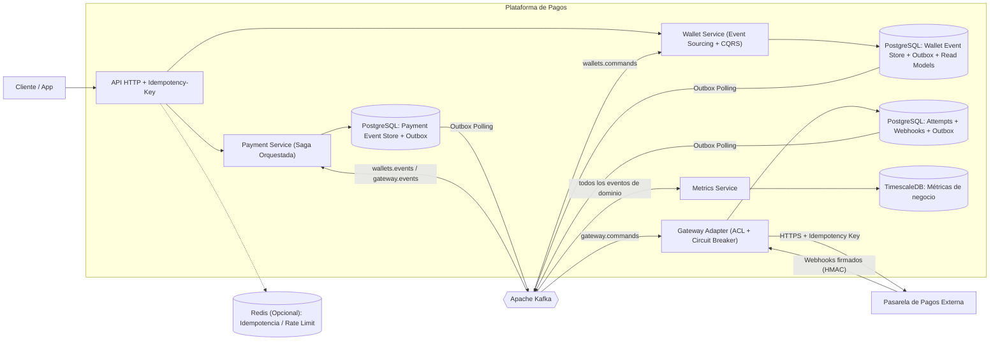
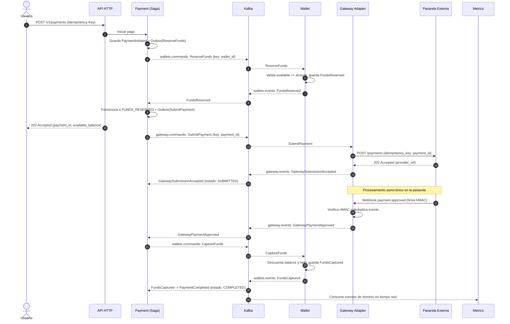
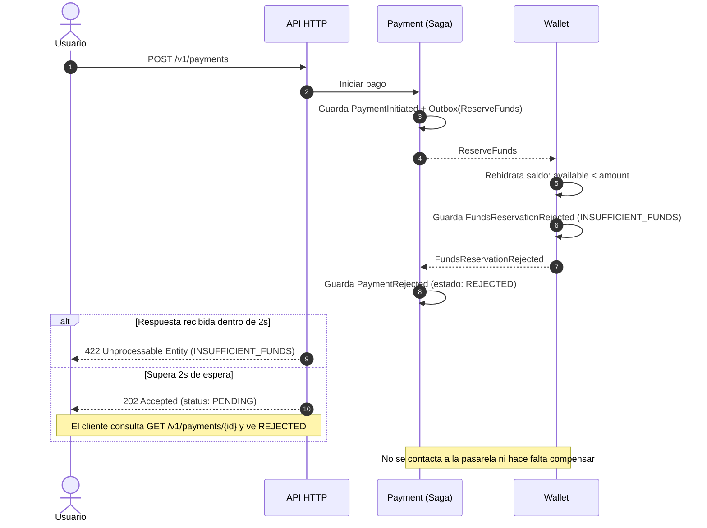
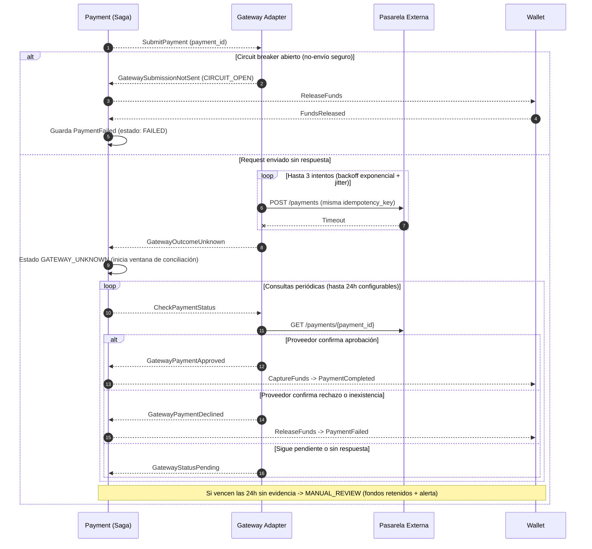
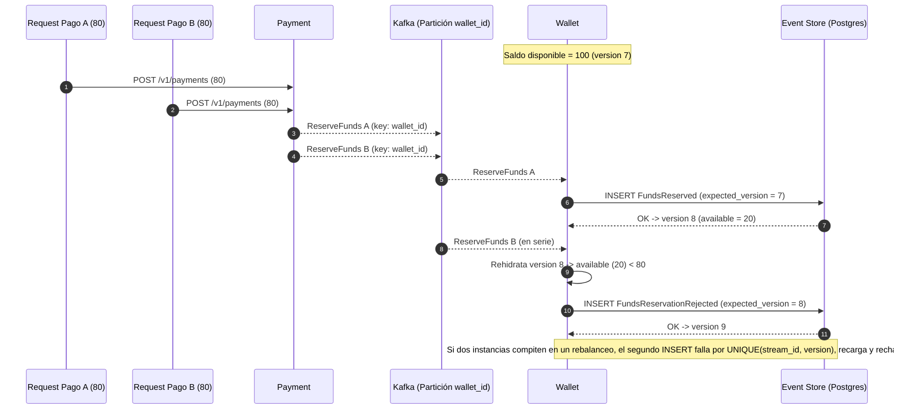
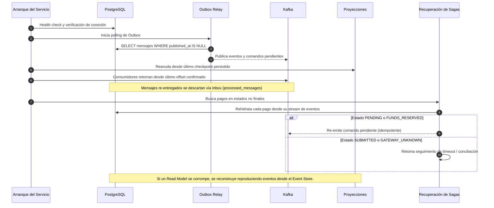

# 01 — Arquitectura del Sistema

## 1. Resumen y supuestos

El sistema permite a los usuarios pagar servicios usando el saldo de su billetera. El cobro se liquida al proveedor del servicio a través de una pasarela externa con respuesta asincrónica, recolectando métricas en tiempo real y garantizando consistencia financiera ante fallas o concurrencia.

### Supuestos principales

1. **Rol de la pasarela externa:** la billetera **financia** el pago y la pasarela **liquida** al proveedor del servicio. La carga de saldo queda fuera de alcance (se contempla un evento `FundsDeposited` para fondear billeteras).
2. **Moneda y montos:** una billetera por usuario y moneda. Todos los montos se expresan como enteros `int64` en unidades mínimas (centavos) más código ISO-4217 (`"ARS"`, `"USD"`), nunca en punto flotante.
3. **Contrato con la pasarela:** soporta una clave de idempotencia por request (`payment_id`), consulta de estado para conciliación y **webhooks firmados con HMAC** para autenticar las respuestas asincrónicas.
4. **Reembolsos:** se soportan reembolsos totales o parciales después de completado un pago.
5. **Alcance de la Parte 2:** se implementa como **monolito modular en Go**, con los módulos desacoplados detrás de interfaces y el broker/base/pasarela simulados en memoria.

---

## 2. Arquitectura de alto nivel

La arquitectura se organiza en **4 servicios** con responsabilidades claras, coordinados a través de Kafka y con almacenamiento lógico independiente por servicio:

### Flujo de datos y patrones de integración

- **Camino de escritura (comandos):** los servicios escriben sus eventos y los mensajes salientes en su propia base PostgreSQL dentro de la **misma transacción** (patrón *Transactional Outbox*). Un worker de polling publica los mensajes pendientes en Kafka, evitando el problema de escritura doble (*dual-write*).
- **Camino de lectura (CQRS):** las consultas de saldo leen un read model actualizado en la misma transacción de escritura para evitar que el usuario vea saldo desactualizado tras pagar (*read-your-writes*). El historial de movimientos y las métricas se actualizan de forma asincrónica desde Kafka.
- **Coordinación híbrida:** `Payment` **orquesta** el flujo financiero (emite comandos a `Wallet` y `Gateway Adapter` y reacciona a sus respuestas). `Metrics` consume los eventos de forma **coreografiada**, sin acoplarse al flujo del pago.

### Puntos de integración externa

| Punto de integración | Dirección | Mecanismo | Protecciones |
|---|---|---|---|
| **Envío de pago** | Gateway Adapter → Pasarela | HTTPS `POST /payments` | `payment_id` como clave de idempotencia, timeout, reintentos con backoff + jitter, circuit breaker |
| **Consulta de estado** | Gateway Adapter → Pasarela | HTTPS `GET /payments/{id}` | Usado durante la conciliación cuando no llega respuesta |
| **Reembolso** | Gateway Adapter → Pasarela | HTTPS `POST /refunds` | `refund_id` como clave de idempotencia |
| **Webhooks de resultado** | Pasarela → Gateway Adapter | HTTPS `POST /v1/webhooks/{provider}` | Validación de firma HMAC, deduplicación por `provider_event_id` y persistencia antes de responder `200` |

---

## 3. Escenarios de flujo de pago

### 3.1 Ruta feliz

Flujo completo desde la solicitud del usuario hasta la liquidación confirmada y la captura definitiva de fondos.

---

### 3.2 Saldo insuficiente (rechazo inmediato)

La validación se hace siempre sobre el aggregate de `Wallet` reconstruido desde sus eventos (nunca sobre una caché). La API espera hasta **2 segundos** el resultado de la reserva para responder `422` de forma inmediata; si la operación tarda más, responde `202` y el cliente consulta el estado luego.

---

### 3.3 Tiempo de espera de pasarela externa (reintento, fallback y conciliación)

Un timeout de la pasarela **no es un rechazo**: el proveedor pudo haber procesado el cobro. Nunca se liberan los fondos sin evidencia negativa. Solo cuando el circuit breaker está abierto (certeza de que el request no salió) se falla y libera de forma segura.

---

### 3.4 Pagos concurrentes (condiciones de carrera)

Ejemplo: billetera con saldo `100` recibe dos pagos simultáneos de `80` (A y B). El sistema protege el saldo con tres capas: idempotencia en la API (doble click), particionado por `wallet_id` en Kafka (procesamiento en serie) y **optimistic locking** en PostgreSQL como red de seguridad definitiva.

---

### 3.5 Recuperación del sistema (reinicio y reconstrucción del estado)

Ante un reinicio abrupto del proceso, el estado no depende de la memoria: los aggregates se reconstruyen desde el Event Store (último snapshot + eventos posteriores), el Outbox retoma publicaciones pendientes y las sagas activas continúan desde su último estado persistido.

