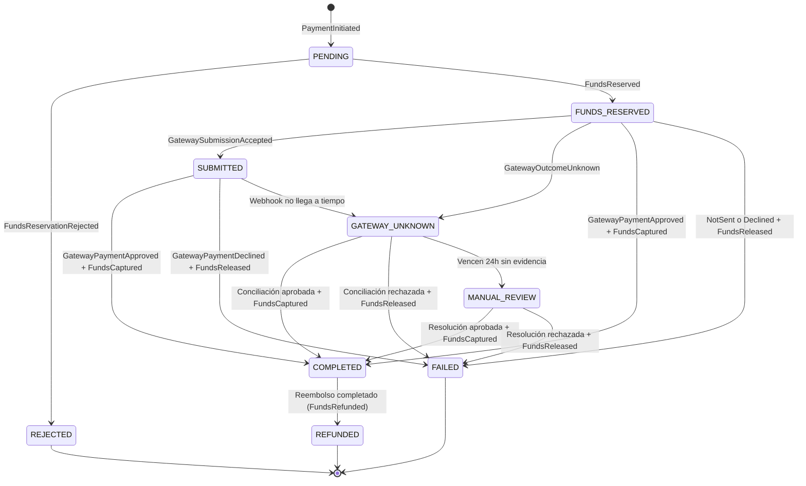

# 03 — Especificación de Diseño de Eventos

## 1. Convenciones y envelope

### Convenciones de nombres

| Elemento | Convención | Ejemplo |
|---|---|---|
| **Eventos** | Hecho en pasado, `PascalCase` | `FundsReserved`, `PaymentCompleted` |
| **Comandos** | Verbo imperativo, `PascalCase` | `ReserveFunds`, `CaptureFunds` |
| **Topics** | `<dominio>.<events\|commands>.v<N>` | `wallets.events.v1`, `wallets.commands.v1` |
| **DLQ** | `<topic>.dlq` | `wallets.commands.v1.dlq` |
| **Streams (Event Store)** | `<aggregate>-<id>` | `wallet-wal_123`, `payment-pay_456` |
| **Montos** | `int64` en centavos + moneda ISO-4217 | `{"amount": 15000, "currency": "ARS"}` |

### Envelope estándar

Todos los eventos y comandos comparten el mismo sobre JSON para garantizar trazabilidad, versionado e idempotencia:

```json
{
  "event_id": "01936f6e-8c1a-7b3e-9d2f-4a5b6c7d8e9f",
  "type": "wallet.FundsReserved",
  "schema_version": 1,
  "aggregate_type": "wallet",
  "aggregate_id": "wal_123",
  "aggregate_version": 8,
  "occurred_at": "2026-11-20T12:30:00.123Z",
  "correlation_id": "pay_456",
  "causation_id": "01936f6e-7a10-7c21-8e3f-1b2c3d4e5f60",
  "payload": {
    "payment_id": "pay_456",
    "amount": { "amount": 15000, "currency": "ARS" },
    "balance_after": 50000,
    "held_after": 15000,
    "available_after": 35000
  }
}
```

- `event_id`: identificador único usado para deduplicación en consumidores (patrón Inbox).
- `correlation_id`: igual a `payment_id`; vincula todos los eventos y logs de un mismo pago.
- `causation_id`: `event_id` del mensaje que disparó la acción actual.
- `schema_version`: permite evolucionar schemas de forma retrocompatible (solo agregar campos opcionales en la misma versión; cambios incompatibles incrementan la versión).

---

## 2. Estructura de topics y claves de partición

| Topic | Tipo | Clave de partición | Productor | Consumidores |
|---|---|---|---|---|
| `payments.events.v1` | Eventos | `payment_id` | Payment | Read Models, Metrics |
| `wallets.commands.v1` | Comandos | `wallet_id` | Payment | Wallet |
| `wallets.events.v1` | Eventos | `wallet_id` | Wallet | Payment (Saga), Read Models, Metrics |
| `gateway.commands.v1` | Comandos | `payment_id` | Payment | Gateway Adapter |
| `gateway.events.v1` | Eventos | `payment_id` | Gateway Adapter | Payment (Saga), Metrics |
| `<topic>.retry.<delay>` | Reintento | Igual al original | Consumidores | Mismo consumer group |
| `<topic>.dlq` | DLQ | Igual al original | Consumidores | Herramienta de redrive / soporte |

---

## 3. Catálogo de comandos y eventos

### 3.1 Comandos

| Topic | Comando | Payload principal | Acción esperada |
|---|---|---|---|
| `wallets.commands.v1` | `ReserveFunds` | `payment_id`, `wallet_id`, `amount` | Reservar saldo disponible |
| `wallets.commands.v1` | `CaptureFunds` | `payment_id`, `wallet_id`, `amount` | Descontar reserva de forma definitiva |
| `wallets.commands.v1` | `ReleaseFunds` | `payment_id`, `wallet_id`, `reason` | Liberar reserva (compensación) |
| `wallets.commands.v1` | `RefundFunds` | `payment_id`, `refund_id`, `wallet_id`, `amount` | Acreditar reembolso en billetera |
| `gateway.commands.v1` | `SubmitPayment` | `payment_id`, `provider`, `amount`, `service_id` | Enviar pago a la pasarela |
| `gateway.commands.v1` | `CheckPaymentStatus` | `payment_id`, `provider` | Consultar estado para conciliación |
| `gateway.commands.v1` | `RefundPayment` | `payment_id`, `refund_id`, `amount`, `provider_ref` | Solicitar reembolso a la pasarela |

### 3.2 Eventos de Wallet (`wallets.events.v1`)

| Evento | Cuándo se emite | Efecto en el saldo |
|---|---|---|
| `WalletCreated` | Alta de billetera | `balance = 0`, `held = 0` |
| `FundsDeposited` | Carga de saldo | `balance += amount` |
| `FundsReserved` | Reserva exitosa (`available >= amount`) | `held += amount` (`available` baja) |
| `FundsReservationRejected` | Saldo insuficiente o moneda inválida | Sin cambio |
| `FundsCaptured` | Cobro definitivo de una reserva activa | `balance -= amount`, `held -= amount` |
| `FundsReleased` | Liberación de reserva activa | `held -= amount` (`available` sube) |
| `FundsRefunded` | Acreditación de un reembolso | `balance += amount` |

### 3.3 Eventos de Payment (`payments.events.v1`)

| Evento | Cuándo se emite | Estado resultante |
|---|---|---|
| `PaymentInitiated` | Se recibe un pago válido por API | `PENDING` |
| `PaymentFundsReserved` | `Wallet` confirma la reserva | `FUNDS_RESERVED` |
| `PaymentRejected` | `Wallet` rechaza la reserva por saldo | `REJECTED` |
| `PaymentSubmitted` | La pasarela acepta el envío (ack) | `SUBMITTED` |
| `PaymentGatewayUnknown` | Timeout sin respuesta tras reintentos | `GATEWAY_UNKNOWN` |
| `PaymentManualReviewRequired` | Vence la ventana de conciliación (24h) sin evidencia | `MANUAL_REVIEW` |
| `PaymentCompleted` | Aprobado por pasarela y capturado en `Wallet` | `COMPLETED` |
| `PaymentFailed` | Rechazado/no enviado y reserva liberada en `Wallet` | `FAILED` |
| `PaymentRefunded` | Reembolso aprobado y acreditado en `Wallet` | `REFUNDED` *(o permanece `COMPLETED` si fue parcial)* |

### 3.4 Eventos de Gateway Adapter (`gateway.events.v1`)

| Evento | Cuándo se emite |
|---|---|
| `GatewaySubmissionAccepted` | La pasarela responde ack (`2xx`) indicando procesamiento asincrónico |
| `GatewaySubmissionNotSent` | Circuit breaker abierto o límite excedido (certeza de no-envío) |
| `GatewayOutcomeUnknown` | Timeout o error de red tras agotar reintentos de envío |
| `GatewayPaymentApproved` | Aprobación recibida por respuesta sincrónica, webhook o conciliación |
| `GatewayPaymentDeclined` | Rechazo explícito o pago inexistente confirmado por el proveedor |
| `GatewayStatusPending` | Consulta de conciliación indica que aún sigue en proceso o sin respuesta |
| `GatewayRefundApproved` / `GatewayRefundDeclined` | Resultado de un reembolso ante el proveedor |

---

## 4. Patrón Saga y máquina de estados

### ¿Por qué Saga Orquestada (con coreografía para efectos secundarios)?

| Criterio | Orquestada (elegida para el flujo financiero) | Coreografiada (elegida para Metrics) |
|---|---|---|
| Visibilidad del estado | Explícita en un solo lugar (`Payment`) | Dispersa entre varios servicios |
| Compensaciones | Centralizadas y fáciles de testear | Repartidas; riesgo de dependencias cíclicas |
| Manejo de timeouts | Un dueño claro (`Payment`) | Nadie coordina los vencimientos |
| Acoplamiento | Moderado hacia los pasos del flujo | Muy bajo (ideal para analítica y notificaciones) |

### Máquina de estados del pago



**Flujo simple de reembolsos:** cuando un pago está en `COMPLETED`, un administrador o el proveedor puede solicitar un reembolso (`RefundPayment` → `GatewayRefundApproved` → `RefundFunds` → `FundsRefunded`). El aggregate `Payment` valida que el acumulado no exceda el monto capturado (`refunded_total + amount <= captured_amount`); si el reembolso es parcial, el pago sigue aceptando reembolsos hasta completar el total y pasar a `REFUNDED`.

---

## 5. Orden de eventos, garantías de entrega e idempotencia

- **Garantía de entrega (*At-least-once*):** mediante Transactional Outbox al publicar y confirmación manual de offset al consumir (solo después de persistir los cambios).
- **Efecto *Exactly-once* vía idempotencia en 3 niveles:**
  1. **API (`Idempotency-Key`):** evita pagos duplicados por doble click o reintentos del cliente.
  2. **Consumidores (Inbox `processed_messages`):** registra cada `event_id` procesado en la misma transacción que actualiza el estado; un mensaje repetido se ignora.
  3. **Pasarela externa (`payment_id` / `refund_id`):** garantiza que reintentar un envío no duplique el cobro en el proveedor.
- **Orden garantizado por entidad:** particionar por `wallet_id` asegura que todos los comandos de una misma billetera lleguen en orden a un único consumidor, minimizando conflictos de concurrencia. No se requiere orden global entre usuarios distintos.

---

## 6. Consideraciones de Event Sourcing

- **Aggregates Event Sourced:** tanto `Wallet` como `Payment` reconstruyen su estado actual aplicando sus eventos en orden. Esto da auditoría financiera completa, trazabilidad de cada transición y recuperación directa ante reinicios.
- **Concurrencia optimista:** la tabla de eventos tiene una restricción única `UNIQUE (stream_id, version)`. Cada escritura pasa `expected_version`; ante un conflicto, el servicio recarga el stream, reevalúa las reglas de negocio y reintenta.
- **Snapshots:** `Wallet` guarda un snapshot cada 100 eventos para evitar reconstruir historiales largos. Los streams de `Payment` son cortos (~6–10 eventos) y no necesitan snapshots.
- **Outbox con polling:** los eventos a publicar se insertan en una tabla `outbox` en la misma transacción que el Event Store. Un worker liviano hace polling de las filas pendientes y las publica en Kafka; si la escala lo justifica en el futuro, puede reemplazarse por CDC (Debezium) sin cambiar el dominio.
